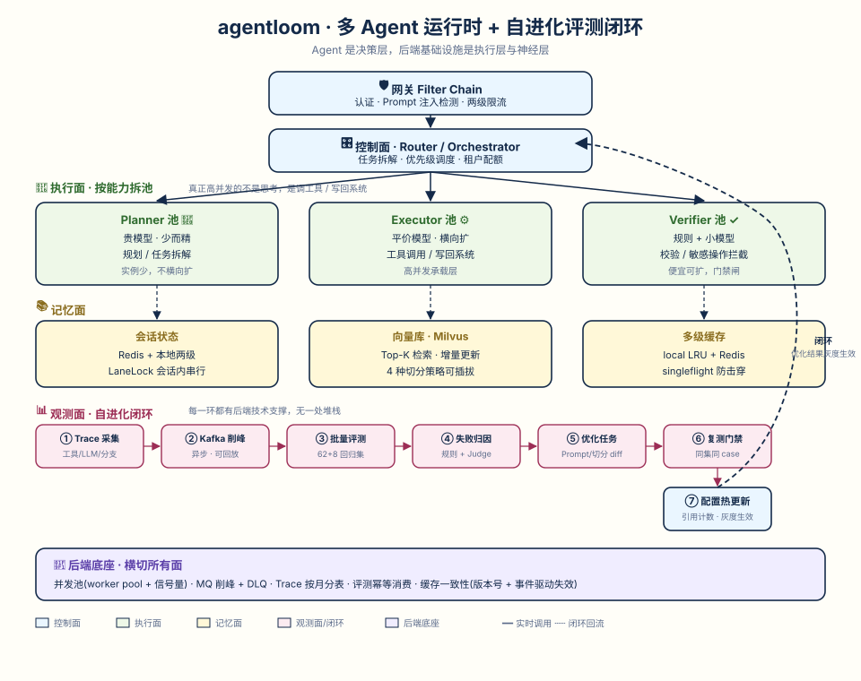

<div align="center">

# agentloom

**A multi-agent runtime that learns from its own traces.**

把 ReAct 循环、MCP 工具、RAG 检索、配置热更新和多 Agent 分层协作做在同一套 Go 平台里，并带一个评测 harness——让 Agent 能基于自己的执行轨迹持续优化检索、Prompt 与工具选择，而不只是跑通就结束的 demo。

[](https://go.dev/)
[](LICENSE)
[](#status)

</div>

> **适合谁**：想在自己的知识库 / 工单 / 问答场景里跑一个可配置、可观测、可自进化 Agent 的后端工程师。Go 单二进制，零外部依赖即可跑起来。

---

## 为什么造这个

市面上的 Agent 项目大多停在"单 Agent + 工具调用 + RAG"的 demo 层。生产里真正难的三个问题很少有人把代码摆出来：

1. **请求放大效应**：用户发 1 条消息，Agent 要跑 3 次 LLM + 2 次工具 + 2 次检索。表面并发 1000，实际是 5000 次 LLM 调用 + 上万次存储访问。**后端并发 / 缓存 / MQ 在 Agent 系统里不是装饰，是刚需。**
2. **没有自进化闭环**：Agent 上线即定稿，失败案例不回流、不归因、不优化，永远在犯同一个错。
3. **多 Agent 不是"塞进一个聊天框"**：而是按能力拆池——贵模型做规划（少而精）、平价模型做执行（横向扩）、规则 + 小模型做校验。

agentloom 把这三件事做在同一套平台里，并且**让每一环都咬合**：配置热更新是自进化闭环的发布通道，网关链是多 Agent 协作的总线，RAG 评测是闭环的第一个优化对象。

## 架构

<p align="center">
  
</p>

详见 [`docs/01-architecture.md`](docs/01-architecture.md)。

## 核心特性

| 特性 | 说明 | 状态 |
|---|---|---|
| **多 Agent 分层协作** | Planner / Executor / Verifier 角色池与消息契约；子任务当前串行执行 | ✅ |
| **Harness 自进化闭环** | 已有独立 Trace/评测原语与离线候选门禁；自动归因、任务生成、线上灰度和回滚尚未串联 | 🚧 |
| **预测式归因** | 每次优化提交声明预期收益，评测验证预测成立与否，逐次变更可归因 | 📋 |
| **配置热更新** | 进程内引用计数替换；etcd Source 尚未实现 | ✅ |
| **MCP 双传输适配** | stdio / HTTP JSON-RPC；请求取消、响应关联校验与有限 JSON Schema 参数校验；写工具默认不重试 | 🚧 |
| **可评测 RAG** | 4 种切分策略可插拔 + 自建 98 条标注评估集，HitRate@K 可一键复现 | ✅ |
| **评测 harness** | Trace + 规则代理评测器 + 词法测试 Prober + Markdown 报告；真实 Judge 尚未接入 | 🚧 |
| **网关治理链** | Filter Chain：本地演示 token、关键词注入信号、单机租户限流 | 🚧 |
| **插件化运行时** | IoC 生命周期：planner/memory/tool/evaluator 可热插拔，mount/reload/dispose 不重置 agent 状态 | ✅ |
| **后端底座** | 内存 Trace 队列、按月分组及内存缓存；尚无持久化、Kafka 或 DLQ | 🚧 |

> ✅ = 已实现且有测试 / 🚧 = 组件就位，运行时串联推进中 / 📋 = 设计完成待实现

## 快速开始

核心模块已实现（config 热更新 / mcp 适配 / rag 4 切分 / eval 评测器 / gateway 治理链 / runtime 插件生命周期 / orchestrator 多 Agent 池 / infra 削峰分表），`go test ./...` 全绿。自进化闭环的端到端串联按 Roadmap 推进。

```bash
git clone https://github.com/XiaoLeng-master/agentloom.git
cd agentloom
make verify      # 格式整理 + vet + 全量 race 测试
make bench       # 输出当前提交的切分策略 HitRate@K 对比表
make run         # 启动 HTTP 入口 agentd，监听 :8080
curl localhost:8080/health   # {"status":"ok","agents":["kb-agent"]}
```

> `make run` 提供确定性本地演示；配置 Manager 已初始化，但演示请求尚未从 Manager 获取版本化配置。

本地端到端演示（确定性演示模型、内存文档检索；不是在线 LLM 或生产知识库）：

```bash
make run
curl -H 'Authorization: Bearer local-demo' -H 'Content-Type: application/json' \
  -d '{"message":"planner executor"}' localhost:8080/v1/chat
# 从返回的 trace_id 查询执行契约：
curl -H 'Authorization: Bearer local-demo' localhost:8080/v1/traces/<trace_id>
```

演示链路经过本地网关、Planner、Executor 的 RAG Tool 和 Verifier，Trace 暂存进程内；远端 MCP、真实模型、批量评测及持久化尚未接入这个入口。

环境：
- Go 1.22+
- 当前仅需 Go 1.22+；真实模型和外部基础设施仍在路线图中。

## 仓库结构

```
agentloom/
├── README.md
├── docs/
│   ├── architecture.svg         # 架构图（源文件）
│   ├── 01-architecture.md        # 四面分层 + 数据流 + 闭环详解
│   ├── 02-design-decisions.md   # 6 个设计取舍（为什么这么做）
│   ├── 03-benchmark.md          # 指标口径与复现命令
│   ├── 04-dataset-construction.md # 98 条评估集怎么标的、怎么扩展
│   ├── 05-evaluation-method.md  # 4 评测器算法 + 门禁规则 + 怎么跑
│   ├── 06-demo-script.md        # 可复现演示脚本
│   └── roadmap.md               # 10 天排期
├── cmd/                          # HTTP 入口（WIP）
├── internal/
│   ├── core/                     # ReAct、factory、registry
│   ├── config/                   # 热更新、引用计数安全替换
│   ├── mcp/                      # stdio/http transport、tool adapter
│   ├── rag/                      # splitter(4 策略)、embedding、store、retriever
│   ├── eval/                     # trace、evaluator、geval、report
│   ├── gateway/                  # filter chain（认证/注入检测/限流）
│   ├── runtime/plugin/           # IoC 插件生命周期（mount/reload/dispose）
│   ├── orchestrator/             # 多 Agent 池（planner/executor/verifier + 消息契约）
│   └── infra/                    # 削峰队列、按月分表、prefix/embed 缓存
├── datasets/rag_eval_98.json     # 自建 98 条标注评估集（公开来源）
├── scripts/                      # bench.sh 与数据集构造脚本
├── examples/                     # 预留示例目录
└── Makefile
```

## 设计取舍（为什么这么做）

详见 [`docs/02-design-decisions.md`](docs/02-design-decisions.md)。核心 6 条：

1. **为什么热更新用 Watch + 引用计数**——新实例预热、旧实例 drain 后下线，做到零中断；纯 Watch 不够，会打断在跑请求。
2. **为什么评测规则优先、LLM-as-Judge 兜底**——规则可复现可解释，Judge 只在规则无因时启用，避免评测器本身飘。
3. **为什么按能力拆池而非按 Agent 拆**——真正高并发的不是"思考"，是"调工具、写回系统"。把稀缺 LLM 推理与大量 I/O 分离，降成本与尾延迟。
4. **为什么 Trace 走 Kafka 异步**——Trace 高频写入不能阻塞会话主链路；Kafka 还能回放做回归。
5. **为什么每次优化带"预测"**——预测的匹配/证伪比分数涨跌多一比特信息，能归因到"你对系统的理解"而非运气。
6. **为什么自建 98 条公开评估集**——私有数据不能开源，公开数据集可复现可审计，clone 下来就能跑。

## Roadmap

见 [`docs/roadmap.md`](docs/roadmap.md)。10 天排期，每天 2-3 小时，从骨架到可演示。

## License

[MIT](LICENSE)
